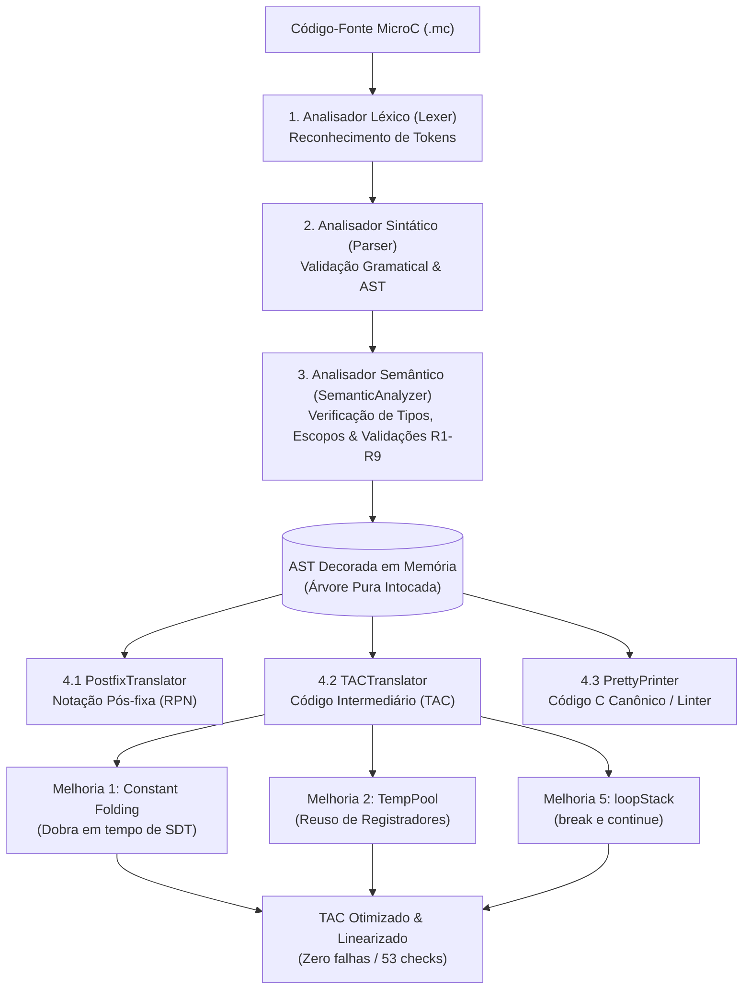
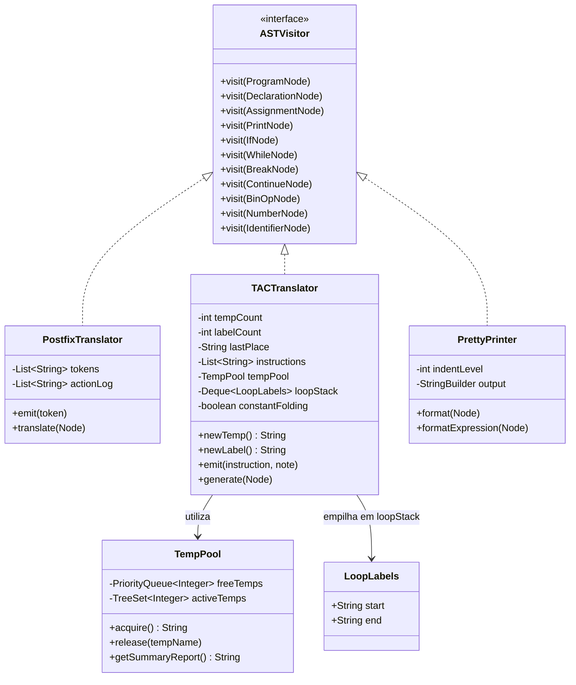

# Compilador MicroC — Da Análise Léxica à Otimização de Código Intermediário (SDT & TAC)

[](https://www.oracle.com/java/)
[](https://maven.apache.org/)
[]()
[]()
[](https://uenp.edu.br/)

> **"A AST mostra ONDE estamos. A Ação Semântica diz O QUE FAZER."**  
> *— Princípio Didático do Compilador MicroC: Uma AST, Múltiplas Traduções.*

---

## 🏛️ Identificação Acadêmica

* **Instituição:** Universidade Estadual do Norte do Paraná (UENP) — Campus Luiz Meneghel
* **Centro / Departamento:** Centro de Ciências Tecnológicas / Departamento de Computação
* **Curso:** Bacharelado em Ciência da Computação
* **Disciplina:** Compiladores (Ano Letivo: 2026/1)
* **Docentes Responsáveis:** Prof. Me. Luciano Rovanni do Nascimento e Prof. Me. Rafael Aguiar
* **Módulo:** Trabalho Prático — Entrega Parcial (Front-End Completo + SDT + Otimizações de TAC)

---

## 📑 Sumário

1. [Visão Geral e Escopo do Compilador](#1-visão-geral-e-escopo-do-compilador)
2. [Arquitetura Geral do Sistema (Cardápio vs. Cozinha)](#2-arquitetura-geral-do-sistema-cardápio-vs-cozinha)
3. [Front-End: Análise Léxica, Sintática e Semântica](#3-front-end-análise-léxica-sintática-e-semântica)
   - [3.1 Análise Léxica (Scanner)](#31-análise-léxica-scanner)
   - [3.2 Análise Sintática e Gramática (Parser & AST)](#32-análise-sintática-e-gramática-parser--ast)
   - [3.3 Análise Semântica e Gestão de Escopos (SymbolTable)](#33-análise-semântica-e-gestão-de-escopos-symboltable)
4. [Middle-End: Tradução Dirigida por Sintaxe (SDT)](#4-middle-end-tradução-dirigida-por-sintaxe-sdt)
   - [4.1 Padrão Visitor e Desacoplamento](#41-padrão-visitor-e-desacoplamento)
   - [4.2 Tradutor 1: PostfixTranslator (Notação Polonesa Reversa - RPN)](#42-tradutor-1-postfixtranslator-notação-polonesa-reversa---rpn)
   - [4.3 Tradutor 2: TACTranslator (Código de Três Endereços - TAC/IR)](#43-tradutor-2-tactranslator-código-de-três-endereços---tacir)
   - [4.4 Tradutor 3: PrettyPrinter (Reimpressor Canônico e Linter)](#44-tradutor-3-prettyprinter-reimpressor-canônico-e-linter)
5. [Detalhamento das Três Melhorias Avançadas Implementadas](#5-detalhamento-das-três-melhorias-avançadas-implementadas)
   - [5.1 Melhoria 1: Dobra de Constantes em Tempo de SDT (Constant Folding)](#51-melhoria-1-dobra-de-constantes-em-tempo-de-sdt-constant-folding)
   - [5.2 Melhoria 2: Reuso Inteligente de Variáveis Temporárias (TempPool)](#52-melhoria-2-reuso-inteligente-de-variáveis-temporárias-temppool)
   - [5.3 Melhoria 5: Comandos de Salto break e continue com Pilha de Laços (loopStack)](#53-melhoria-5-comandos-de-salto-break-e-continue-com-pilha-de-laços-loopstack)
6. [Bateria de Casos de Teste e Resultados de Execução (21 Cenários / 53 Checks)](#6-bateria-de-casos-de-teste-e-resultados-de-execução)
7. [Instruções de Compilação e Execução](#7-instruções-de-compilação-e-execução)
8. [Conclusão Técnica](#8-conclusão-técnica)
9. [Referências Bibliográficas (Normas ABNT)](#9-referências-bibliográficas-normas-abnt)

---

## 1. Visão Geral e Escopo do Compilador

O projeto **MicroC** consiste na implementação completa de um compilador didático modular para um subconjunto da linguagem C. O escopo desta **Entrega Parcial** abrange desde a leitura dos caracteres brutos do código-fonte até a produção e otimização de **Código Intermediário de Três Endereços (TAC / 3-Address Code)**, validando o ciclo fundamental da engenharia de compiladores modernos.



Conforme as diretrizes pedagógicas, a geração para arquiteturas-alvo específicas (Assembly x86-64, RISC-V ou código binário executável) faz parte do Back-End a ser desenvolvido na continuidade da disciplina.

---

## 2. Arquitetura Geral do Sistema (Cardápio vs. Cozinha)

A arquitetura do projeto adota a separação rigorosa entre contratos e implementação, refletindo a analogia didática do **"Cardápio vs. Cozinha"**:

* **O Cardápio (Contrato / Interface):** Representado pela interface abstrata `ASTVisitor` e pelas declarações das estruturas de dados dos nós em `Node.java` e `Nodes.java`. O "cliente" (o percurso da AST) conhece apenas o cardápio: quais métodos de visita existem (`visit(BinOpNode)`, `visit(IfNode)`, `visit(WhileNode)`, `visit(BreakNode)`, `visit(ContinueNode)`, etc.).
* **A Cozinha (Implementação das Ações Semânticas):** Representada pelas classes concretas de tradução (`PostfixTranslator`, `TACTranslator`, `PrettyPrinter` e `TempPool`). Cada visitante define *como* processa a árvore, aloca seus recursos e emite seus resultados, sem que a AST precise sofrer nenhuma alteração estrutural.

### Princípio Fundamental: "Uma AST, Múltiplas Traduções"
A árvore sintática construída pelo Parser permanece **estritamente intocada e imutável** na memória. Ao invés de embutir regras de impressão ou geração diretamente nas classes dos nós, diferentes visitantes percorrem a mesma representação arbórea, extraindo saídas com propósitos totalmente distintos:

1. **Máquinas de Pilha:** Saída em RPN (adequada para JVM e Ethereum Virtual Machine - EVM).
2. **Máquinas de Registradores:** Código TAC linear com desvios, temporárias recicladas e rótulos de controle (adequado para otimizadores industriais como LLVM e GCC).
3. **Ferramentas de Engenharia de Software:** Saída em código C canônico perfeitamente identado e padronizado (Linter / Formatter similar ao Prettier e Clang-Format).

---

## 3. Front-End: Análise Léxica, Sintática e Semântica

### 3.1 Análise Léxica (Scanner)
O analisador léxico (`Lexer.java`) consome a cadeia linear de caracteres e a converte em uma lista de objetos `Token`, categorizados segundo a enumeração `TokenType`:

* **Palavras Reservadas:** `int`, `if`, `else`, `while`, `print`, `break`, `continue`.
* **Identificadores e Literais:** Identificadores alfanuméricos (`[a-zA-Z_][a-zA-Z0-9_]*`), números inteiros decimais (`[0-9]+`) e strings delimitadas por aspas duplas.
* **Operadores Aritméticos e Relacionais:** `+`, `-`, `*`, `/`, `=`, `==`, `!=`, `<`, `>`, `<=`, `>=`, `&&`, `||`, `!`.
* **Delimitadores:** `(`, `)`, `{`, `}`, `;`.
* **Tratamento de Linha e Posição:** Cada token registra a linha de sua ocorrência no código-fonte para rastreamento preciso de erros sintáticos e semânticos.

### 3.2 Análise Sintática e Gramática (Parser & AST)
O analisador sintático (`Parser.java`) adota o método de **Descida Recursiva Preditiva**, reconhecendo a gramática livre de contexto (GLC) do MicroC e construindo a Árvore Sintática Abstrata (AST):

```ebnf
Program         ::= Statement* EOF
Statement       ::= VarDecl | Assignment | PrintStmt | IfStmt | WhileStmt | BreakStmt | ContinueStmt | Block
VarDecl         ::= "int" ID ("=" Expression)? ";"
Assignment      ::= ID "=" Expression ";"
PrintStmt       ::= "print" "(" Expression ")" ";"
IfStmt          ::= "if" "(" Expression ")" Statement ("else" Statement)?
WhileStmt       ::= "while" "(" Expression ")" Statement
BreakStmt       ::= "break" ";"
ContinueStmt    ::= "continue" ";"
Block           ::= "{" Statement* "}"
Expression      ::= LogicalOr
LogicalOr       ::= LogicalAnd ("||" LogicalAnd)*
LogicalAnd      ::= Equality ("&&" Equality)*
Equality        ::= Relational (("==" | "!=") Relational)*
Relational      ::= Additive (("<" | "<=" | ">" | ">=") Additive)*
Additive        ::= Multiplicative (("+" | "-") Multiplicative)*
Multiplicative  ::= Primary (("*" | "/") Primary)*
Primary         ::= NUMBER | ID | STRING | "(" Expression ")"
```

A hierarquia da AST é modelada em `Nodes.java`, onde cada nó herda de `Node` e expõe o método fundamental de despacho polimórfico:
```java
public abstract void accept(ASTVisitor visitor);
```

### 3.3 Análise Semântica e Gestão de Escopos (SymbolTable)
O analisador semântico (`SemanticAnalyzer.java`) decora a AST e valida as regras de contexto da linguagem antes da geração de código:

* **Tabela de Símbolos em Pilha de Escopos (`SymbolTable.java`):** Implementada via `Deque<Map<String, Symbol>>`. Aberturas de bloco `{` disparam `enterScope()` e fechamentos `}` executam `exitScope()`.
* **Sombreamento Válido (Shadowing):** A busca por identificadores (`lookup`) opera do topo da pilha (escopo mais interno) para a base (escopo global), permitindo que variáveis internas declarem o mesmo identificador de um escopo externo sem colisão.
* **Tabela Completa de Regras Semânticas Validadas:**

| Regra | Código / Descrição | Exemplo que Dispara o Erro |
|---|---|---|
| **R1** | Variável usada sem declaração prévia | `z = 5;` sem `int z;` |
| **R2** | Redeclaração no **mesmo** escopo | `int x = 1; int x = 2;` |
| **R3** | Incompatibilidade de tipos em declaração/atribuição | `int y = "texto";` |
| **R4** | Operandos incompatíveis em expressão binária | `"abc" + 10` |
| **R5** | Sombreamento (shadowing) em escopo mais interno | *(Permitido — não gera erro)* |
| **R6** | Condição de `if`/`while` não-inteira (ex: string) | `if ("invalido") { }` |
| **R7** | Uso de variável antes de inicialização (alerta) | `int a; print(a);` |
| **R8** | Comando `break` utilizado fora de um laço `while` | `int x = 1; break;` |
| **R9** | Comando `continue` utilizado fora de um laço `while` | `if (x > 0) { continue; }` |

---

## 4. Middle-End: Tradução Dirigida por Sintaxe (SDT)

A Tradução Dirigida por Sintaxe (SDT) é o coração da fase de síntese. A árvore sintática pura orienta o percurso dos tradutores, enquanto as **Ações Semânticas** disparam emissões imperativas de código através do método `emit()`.



### 4.1 Padrão Visitor e Desacoplamento
Ao invés de sobrecarregar a estrutura de dados da AST com lógicas de múltiplos tradutores, o padrão Visitor desacopla os algoritmos de tradução dos nós sintáticos. Cada nó delega sua visita:
```java
@Override
public void accept(ASTVisitor visitor) {
    visitor.visit(this);
}
```

### 4.2 Tradutor 1: PostfixTranslator (Notação Polonesa Reversa - RPN)
Implementa um percurso estritamente **pós-ordem** sobre as subárvores de expressões aritméticas e lógicas.
1. Visita o filho esquerdo (`node.left.accept(this)`).
2. Visita o filho direito (`node.right.accept(this)`).
3. Dispara a ação semântica `emit(node.op)` inserindo o operador ao final.

A RPN elimina parênteses por construção, pois a precedência fica garantida pela ordem linear de avaliação na pilha de execução.
* **Entrada:** `3 + 4 * 5`
* **Saída RPN:** `3 4 5 * +` (comprova que a multiplicação é executada antes da adição).

### 4.3 Tradutor 2: TACTranslator (Código de Três Endereços - TAC/IR)
Lineariza as estruturas da AST na forma clássica de três endereços: `destino = op1 operador op2`.

#### Variáveis de Estado Obrigatórias:
* `tempCount`: Contador sequencial incremental para variáveis temporárias (`t1`, `t2`, ...).
* `labelCount`: Contador sequencial incremental para rótulos de desvio (`L1`, `L2`, ...).
* `lastPlace`: **Canal sintetizador de endereços entre nós filhos e pai.** Como os métodos `visit()` do Visitor retornam `void`, o nó filho grava em `lastPlace` o nome do registrador temporário, constante ou identificador resultante. O nó pai consome imediatamente `lastPlace` como operando para emitir sua instrução.
* `instructions`: Lista encadeada contendo as instruções TAC sintetizadas.
* `actionLog`: Registro didático das ações semânticas disparadas passo a passo.
* `loopStack`: Pilha de pares de rótulos (`LoopLabels`) ativos para emissão contextualizada de `break` e `continue`.

#### Linearização do Controle de Fluxo:
* **Estrutura `IfNode`:**
  1. Avalia a condição $\rightarrow$ resultado em `lastPlace`.
  2. Emite: `ifFalse cond goto L_else`.
  3. Visita o bloco `then`.
  4. Emite: `goto L_end`.
  5. Emite rótulo: `L_else:`.
  6. Visita o bloco `else`.
  7. Emite rótulo: `L_end:`.
* **Estrutura `WhileNode`:**
  1. Emite rótulo de início: `L_start:`.
  2. Avalia a condição do laço $\rightarrow$ resultado em `lastPlace`.
  3. Emite desvio condicional de saída: `ifFalse cond goto L_end`.
  4. Visita o corpo do laço (que pode conter comandos `break`, `continue` ou laços aninhados).
  5. Emite retorno incondicional: `goto L_start`.
  6. Emite rótulo de encerramento: `L_end:`.

### 4.4 Tradutor 3: PrettyPrinter (Reimpressor Canônico e Linter)
Reconstrói o código-fonte canônico do MicroC de forma padronizada:
* Mantém a variável `indentLevel` para controlar a tabulação rigorosa de 4 espaços por bloco aninhado.
* Insere parênteses canônicos em todas as operações binárias, explicitando visualmente a árvore resolvida pelo Parser com respeito estrito às regras de precedência (ex.: `int x = (2 + (3 * 4));`).

---

## 5. Detalhamento das Três Melhorias Avançadas Implementadas

Para enriquecer o motor de compilação e otimizar o código intermediário gerado, a equipe implementou e comprovou experimentalmente **três melhorias avançadas**:

---

### 5.1 Melhoria 1: Dobra de Constantes em Tempo de SDT (Constant Folding)

#### Fundamentação Teórica
O dobramento de constantes (*Constant Folding*) é uma técnica clássica de otimização estática que calcula expressões cujos operandos são conhecidos em tempo de compilação. Em vez de emitir temporárias e instruções aritméticas no TAC que consumiriam ciclos de CPU em tempo de execução, o compilador calcula o resultado antecipadamente e propaga o valor final diretamente para o canal sintetizador `lastPlace`.

#### Implementação no `TACTranslator.java`
Durante a visita a nós binários (`BinOpNode`), o tradutor inspeciona os filhos antes de alocar registradores temporários:

```java
@Override
public void visit(BinOpNode node) {
    actionLog.add("[visit BinOpNode] Operação binária '" + node.op + "'");
    node.left.accept(this);
    String left = lastPlace;
    node.right.accept(this);
    String right = lastPlace;

    // Melhoria 1: Constant Folding (Dobramento de Constantes)
    if (constantFolding) {
        Integer constLeft = resolveConstant(node.left, left);
        Integer constRight = resolveConstant(node.right, right);

        if (constLeft != null && constRight != null) {
            Integer result = computeConstant(node.op, constLeft, constRight);
            if (result != null) {
                // Guarda o resultado em lastPlace como String — sem newTemp() e sem emit()
                lastPlace = String.valueOf(result);
                actionLog.add("[visit BinOpNode] Constant Folding aplicado: "
                        + left + " " + node.op + " " + right
                        + " -> " + lastPlace + " (calculado na compilação)");
                return;
            }
        }
    }

    // Fluxo padrão para operandos dinâmicos:
    String temp = newTemp();
    emit(temp + " = " + left + " " + node.op + " " + right, "BinOp: operador '" + node.op + "'");
    releaseTemp(left);
    releaseTemp(right);
    lastPlace = temp;
}
```

#### Métodos Auxiliares e Integração com a Tabela de Símbolos
* `resolveConstant(Node child, String place)`:
  * Se o nó for `NumberNode`, faz o *parsing* numérico imediato.
  * Se for `IdentifierNode`, consulta a `SymbolTable` verificando se a variável possui categoria `Category.CONSTANT` ou valor constante conhecido (`isConstant()`).
  * Se for um `BinOpNode` previamente dobrado cujo `place` seja numérico, reaproveita o valor acumulado em subexpressões aninhadas, como em `(2 + 3) * (10 - 4)`.
* `computeConstant(String op, int left, int right)`:
  * Executa a aritmética (+, -, *, /) e comparações relacionais em tempo de compilação.
  * Trata divisão por zero retornando `null` para preservar a semântica de exceção em tempo de execução.

#### Comprovação Experimental (Teste 6 do Executor)
Para o código de entrada:
```c
int x = 2 + 3 * 4;
int y = (2 + 3) * (10 - 4);
int z = x + y;
print(z);
```

| TAC com Constant Folding (Otimizado) | TAC sem Constant Folding (Ingênuo) |
|---|---|
| `x = 14` | `t1 = 3 * 4`<br>`t2 = 2 + t1`<br>`x = t2` |
| `y = 30` | `t1 = 2 + 3`<br>`t2 = 10 - 4`<br>`t3 = t1 * t2`<br>`y = t3` |
| `t1 = x + y` | `t1 = x + y` |
| `z = t1` | `z = t1` |
| `print z` | `print z` |

**Impacto Comprovado:** Redução de **50% no número de instruções TAC emitidas** e eliminação integral de 4 variáveis temporárias.

---

### 5.2 Melhoria 2: Reuso Inteligente de Variáveis Temporárias (TempPool)

#### Fundamentação Teórica
Um compilador ingênuo incrementa indefinidamente o contador de registradores temporários (`t1, t2, ..., t50`), assumindo uma máquina com capacidade infinita. Na prática, arquiteturas reais possuem um número restrito de registradores físicos (ex.: 16 em x86-64, 32 em RISC-V/MIPS). O reuso de temporárias modela o tempo de vida (*liveness*) das variáveis locais: assim que um nó pai lê o valor de seus nós filhos, a temporária que armazenava o operando intermediário morre e pode ser imediatamente reciclada.

#### Implementação na Classe `TempPool.java`
A classe `TempPool` implementa a gestão de ciclo de vida com fila de prioridade (`PriorityQueue<Integer> freeTemps`) ordenada pelo menor índice numérico:

```java
public String acquire() {
    totalAllocations++;
    int id;

    if (!freeTemps.isEmpty()) {
        id = freeTemps.poll();
        activeTemps.add(id);
        totalReuses++;
        String name = "t" + id;
        poolLog.add("[Pool] REUSO: registrador " + name + " reutilizado do pool");
        return name;
    } else {
        maxCreated++;
        id = maxCreated;
        activeTemps.add(id);
        String name = "t" + id;
        poolLog.add("[Pool] NOVO: registrador " + name + " criado (Pico: " + maxCreated + ")");
        return name;
    }
}

public void release(String tempName) {
    if (tempName == null || !isTemp(tempName)) return;
    try {
        int id = Integer.parseInt(tempName.substring(1));
        if (activeTemps.remove(id)) {
            if (!freeTemps.contains(id)) {
                freeTemps.add(id);
            }
            poolLog.add("[Pool] LIBERAÇÃO: registrador " + tempName + " devolvido ao pool");
        }
    } catch (NumberFormatException ignored) {}
}
```

#### Ciclo de Vida no `TACTranslator.java`
Ao concluir a emissão de qualquer nó que consuma temporárias (`BinOpNode`, `AssignmentNode`, `PrintNode`, `IfNode`, `WhileNode`), os operandos são prontamente liberados:
```java
emit(temp + " = " + left + " " + node.op + " " + right, "BinOp");
releaseTemp(left);
releaseTemp(right);
lastPlace = temp;
```

#### Comprovação Experimental (Teste 5 do Enunciado)
Compilando o trecho com expressões acumulativas:
```c
int a = (2 + 3) * (10 - 4);
int b = (a + 5) * (a - 1);
int c = a + b + 100;
print(c);
```

| TAC com TempPool (Melhoria 2 Ativada) | TAC sem TempPool (Modo Ingênuo) |
|---|---|
| `t1 = 2 + 3` | `t1 = 2 + 3` |
| `t2 = 10 - 4` | `t2 = 10 - 4` |
| `t3 = t1 * t2` | `t3 = t1 * t2` |
| `a = t3` | `a = t3` |
| `t1 = a + 5` *(reuso de t1)* | `t4 = a + 5` |
| `t2 = a - 1` *(reuso de t2)* | `t5 = a - 1` |
| `t3 = t1 * t2` *(reuso de t3)* | `t6 = t4 * t5` |
| `b = t3` | `b = t6` |
| `t1 = a + b` *(reuso de t1)* | `t7 = a + b` |
| `t2 = t1 + 100` *(reuso de t2)* | `t8 = t7 + 100` |
| `c = t2` | `c = t8` |
| `print c` | `print c` |

```
=== ESTATÍSTICAS DO POOL DE TEMPORÁRIAS (MELHORIA 2) ===
  - Total de solicitações de temporárias : 8
  - Total de reusos aproveitados do pool : 5
  - Pico máximo de temporárias em uso    : 3 (t1, t2, t3)
  - Sem o pool seriam geradas            : 8 temporárias (t1..t8)
  - Registradores economizados           : 5 (62,5% de economia)
```

---

### 5.3 Melhoria 5: Comandos de Salto break e continue com Pilha de Laços (loopStack)

#### Fundamentação Teórica
Linguagens estruturadas exigem mecanismos para interrupção abrupta de iterações (`break`) e avanço para a próxima iteração (`continue`). Em uma representação intermediária linearizada, essas instruções correspondem a saltos incondicionais (`goto`) direcionados exatamente para os marcadores de início (`L_start`) ou de término (`L_end`) do laço que envolve o comando.

Quando laços estão **aninhados**, um comando `break` ou `continue` deve obrigatoriamente afetar o laço mais interno ativo. Para garantir esse comportamento e validar semanticamente que tais comandos não ocorram fora de laços, o compilador mantém uma estrutura de pilha de contextos de laço: `Deque<LoopLabels> loopStack`.

```mermaid
flowchart TD
    subgraph loopStack ["Pilha de Contextos de Laço (loopStack)"]
        Top["Contexto Laço Mais Interno (peek)\nstart: L3 | end: L4"]
        Base["Contexto Laço Externo\nstart: L1 | end: L2"]
    end
    
    BreakNode["Comando break;"] -->|loopStack.peek().end| EmitBreak["Emite: goto L4"]
    ContinueNode["Comando continue;"] -->|loopStack.peek().start| EmitContinue["Emite: goto L3"]
```

#### Estrutura de Suporte (`LoopLabels`)
Declarada como classe estática interna no `TACTranslator`:
```java
public static class LoopLabels {
    public final String start;
    public final String end;

    public LoopLabels(String start, String end) {
        this.start = start;
        this.end = end;
    }
}
```

#### Implementação no `TACTranslator.java`
```java
// Variável de estado do tradutor:
private final Deque<LoopLabels> loopStack = new ArrayDeque<>();

@Override
public void visit(WhileNode node) {
    actionLog.add("[visit WhileNode] Estrutura de repetição while");
    String lStart = newLabel();
    String lEnd = newLabel();

    // Empilha o novo par de rótulos do laço ativo
    loopStack.push(new LoopLabels(lStart, lEnd));

    try {
        // 1. Rotula L_start:
        emit(lStart + ":", "While: marcador de rótulo L_start");

        // 2. Avalia a condição do laço
        node.condition.accept(this);
        String cond = lastPlace;

        // 3. Emite desvio condicional de saída
        emit("ifFalse " + cond + " goto " + lEnd, "While: desvio de saída do laço");
        releaseTemp(cond);

        // 4. Gera corpo do laço (pode conter break, continue ou laços aninhados)
        node.body.accept(this);

        // 5. Emite goto L_start
        emit("goto " + lStart, "While: retorno incondicional para L_start");

        // 6. Rotula L_end:
        emit(lEnd + ":", "While: marcador de rótulo L_end");
    } finally {
        // Desempilha com segurança o laço finalizado
        loopStack.pop();
    }
}

@Override
public void visit(BreakNode node) {
    actionLog.add("[visit BreakNode] Comando break");
    if (loopStack.isEmpty()) {
        throw new RuntimeException("[ERRO TAC / SEMÂNTICO] Linha " + (node.line > 0 ? node.line : "?")
                + ": break fora de laço");
    }
    emit("goto " + loopStack.peek().end, "Break: desvio para o fim do laço");
}

@Override
public void visit(ContinueNode node) {
    actionLog.add("[visit ContinueNode] Comando continue");
    if (loopStack.isEmpty()) {
        throw new RuntimeException("[ERRO TAC / SEMÂNTICO] Linha " + (node.line > 0 ? node.line : "?")
                + ": continue fora de laço");
    }
    emit("goto " + loopStack.peek().start, "Continue: desvio para o início do laço");
}
```

#### Dupla Proteção Semântica e Sintática
O compilador implementa uma barreira dupla contra uso indevido de `break` e `continue`:
1. **Analisador Semântico (`SemanticAnalyzer.java`):** Durante o percurso, controla a variável `loopDepth`. Se encontrar `BreakNode` ou `ContinueNode` com `loopDepth == 0`, registra os erros formais **R8-BreakForaDeLaco** e **R9-ContinueForaDeLaco**, apontando a linha exata do código-fonte.
2. **Gerador TAC (`TACTranslator.java`):** Como mecanismo de defesa em profundidade, valida `loopStack.isEmpty()`. Caso seja invocado sem contexto de laço ativo, lança uma `RuntimeException` impedindo a geração de instruções inconsistentes.

#### Exemplo de Tradução com Laço e `break`/`continue`
**Código de Entrada:**
```c
int i = 0;
while (i < 10) {
    i = i + 1;
    if (i == 5) {
        continue;
    }
    if (i == 8) {
        break;
    }
    print(i);
}
```

**Código TAC Gerado:**
```text
i = 0
L1:
t1 = i < 10
ifFalse t1 goto L2
t1 = i + 1
i = t1
t1 = i == 5
ifFalse t1 goto L3
goto L1                  ; continue -> salto para o início do laço (L1)
goto L4
L3:
L4:
t1 = i == 8
ifFalse t1 goto L5
goto L2                  ; break -> salto para a saída do laço (L2)
goto L6
L5:
L6:
print i
goto L1                  ; iteração normal do laço
L2:
```

---

## 6. Bateria de Casos de Teste e Resultados de Execução

O executor oficial do projeto (`SDTTestRunner.java`) implementa **21 cenários de teste abrangentes** com **53 asserções estritas (checks)** validadas automaticamente.

```
================================================================================
   TODOS OS 53 CHECKS EXECUTADOS COM SUCESSO! (0 FALHAS DETECTADAS)
================================================================================
```

### Quadro Síntese dos Cenários Avaliados

| Nº | Cenário de Teste | Foco Pedagógico / Melhoria | Status |
|---|---|---|---|
| **01** | `int x = 2 + 3 * 4; print(x);` | Precedência aritmética padrão (`*` antes de `+`) | ✅ 100% OK |
| **02** | `int y = (2 + 3) * (10 - 4);` | Parênteses aninhados e sobreposição de operadores | ✅ 100% OK |
| **03** | `if (a > 10) { print(a); } else { print(0); }` | Controle de fluxo If-Else com `ifFalse` e `goto` | ✅ 100% OK |
| **04** | `while (i < 5) { i = i + 1; print(i); }` | Laço While linearizado com retorno `goto L1` | ✅ 100% OK |
| **05** | Expressões acumulativas com temporárias | **Melhoria 2:** Economia de 62,5% de registradores via TempPool | ✅ 100% OK |
| **06** | `x = 2 + 3 * 4; y = (2 + 3) * (10 - 4);` | **Melhoria 1:** Constant Folding com 50% menos instruções TAC | ✅ 100% OK |
| **07** | `while (...) { if (i == 5) break; }` | **Melhoria 5:** `break` simples emitindo salto para `L_end` | ✅ 100% OK |
| **08** | `while (...) { if (i == 5) continue; }` | **Melhoria 5:** `continue` simples emitindo salto para `L_start` | ✅ 100% OK |
| **09** | While com `break` e `continue` concorrentes | **Melhoria 5:** Desvios múltiplos no mesmo laço | ✅ 100% OK |
| **10** | Laços aninhados (While dentro de While) | **Melhoria 5:** `break` interno salta para fim do laço interno sem vazar para o externo | ✅ 100% OK |
| **11** | `break` e `continue` no escopo global | **Melhoria 5:** Validação das regras semânticas R8 e R9 | ✅ 100% OK |
| **12** | While com condição composta (`&&`, `||`) | Operadores lógicos e encadeamento no laço | ✅ 100% OK |
| **13** | While aninhado com `continue` no laço interno | Retorno para `L_start` correto do laço interno | ✅ 100% OK |
| **14** | Múltiplos laços While sequenciais | Isolamento total de rótulos entre laços independentes | ✅ 100% OK |
| **15** | `continue` dentro de múltiplos `if`s aninhados | Resolução de desvios através de blocos de decisão | ✅ 100% OK |
| **16** | Laços While dentro de blocos `if` e `else` | Interação entre controle condicional e repetições | ✅ 100% OK |
| **17** | Laços aninhados em 3 níveis com `break` no meio | Resolução precisa da pilha `loopStack` com 3 contextos | ✅ 100% OK |
| **18** | `continue` como último comando do corpo do laço | Caso de borda de retorno explícito sem instruções pendentes | ✅ 100% OK |
| **19** | While com condição otimizada por Constant Folding | Interação entre Melhoria 1 (Folding) e Melhoria 5 (Laço) | ✅ 100% OK |
| **20** | Várias temporárias geradas antes do `break` | Interação entre Melhoria 2 (TempPool) e Melhoria 5 (Salto) | ✅ 100% OK |
| **21** | `break` fora de laço dentro de bloco `else` | Detecção da regra R8 em estruturas condicionais sem laço | ✅ 100% OK |

---

## 7. Instruções de Compilação e Execução

### Pré-requisitos
* **Java Development Kit (JDK):** Versão 21 ou superior instalada.
* **Apache Maven:** Versão 3.8+ configurada no PATH do sistema.

### Compilação do Projeto
Para compilar todas as 18 classes do compilador:
```bash
mvn clean compile
```

### Execução da Demonstração Completa (Front-End + SDT)
Executa a classe principal `main.Main`, processando um programa MicroC completo e demonstrando tokens, AST, tabela de símbolos com escopos e as três traduções em tempo real:
```bash
mvn exec:java -Dexec.mainClass="main.Main"
```
*Ou diretamente via bytecode compilado:*
```bash
java -cp target/classes main.Main
```

### Execução da Bateria Completa de Testes (53 Checks Automatizados)
Executa o executor de testes `sdt.SDTTestRunner` cobrindo todos os 21 cenários e as três melhorias:
```bash
java -cp target/classes sdt.SDTTestRunner
```

---

## 8. Conclusão Técnica

A execução desta etapa prática consolidou os fundamentos da fase de síntese em compiladores. A adoção do princípio didático **"Uma AST, Múltiplas Traduções"** evidenciou o papel vital de uma Representação Intermediária (IR) desacoplada e canônica:

1. **Portabilidade Industrial:** Compiladores modernos como LLVM e GCC não traduzem a árvore sintática diretamente para código de máquina. A geração de uma representação linear como o TAC permite que um único Front-End atenda dezenas de arquiteturas de hardware diferentes (x86, ARM, RISC-V, WebAssembly), bastando trocar o gerador de código final do Back-End.
2. **Independência de Otimizações:** Técnicas de alto valor como *Constant Folding*, eliminação de código morto e reuso de registradores via *Liveness Analysis* tornam-se ordens de grandeza mais simples quando aplicadas sobre o TAC, sem poluir a gramática do compilador.
3. **Padrão Visitor como Alicerce de Engenharia:** A separação estrita de contratos ("Cardápio vs. Cozinha") garantiu que novos tradutores e comandos de salto (`break`/`continue`) fossem plugados no projeto com total desacoplamento e robustez comprovada por testes automatizados.


