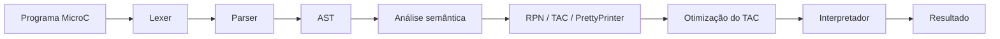

# Compilador MicroC

Projeto didático de compilador para um subconjunto de MicroC, implementado em
**Java 21**. Este README serve como visão geral e roteiro para apresentação:
mostra a arquitetura, a gramática, exemplos de transformação e como executar a
demonstração.

## 1. Código-fonte e arquitetura

O código-fonte completo está em [`src/main/java/`](src/main/java/). O pipeline
integra as fases abaixo; cada etapa recebe a saída da anterior:



| Pacote | Papel na integração |
|---|---|
| [`lexer`](src/main/java/lexer/) | Converte caracteres em tokens e informa erros léxicos |
| [`parser`](src/main/java/parser/) e [`ast`](src/main/java/ast/) | Validam a sintaxe e representam o programa em uma árvore |
| [`semantic`](src/main/java/semantic/) | Verifica tipos, declarações, inicialização e escopos |
| [`sdt`](src/main/java/sdt/) | Traduz a AST para RPN/TAC e formata o código |
| [`optimizer`](src/main/java/optimizer/) | Simplifica e remove instruções desnecessárias do TAC |
| [`backend`](src/main/java/backend/) | Executa o TAC e armazena saídas e valores |

O fluxo executável está em [`CompilerPipeline`](src/main/java/backend/CompilerPipeline.java);
as demonstrações são orquestradas por [`Main`](src/main/java/main/Main.java).

## 2. Front-end: gramática, sintaxe e semântica

O lexer reconhece palavras reservadas, identificadores, operadores,
comentários, strings e literais inteiros/decimais. O parser usa **descida
recursiva** para construir a AST e respeita a precedência dos operadores.
Uma versão resumida da gramática reconhecida é:

```ebnf
Programa       ::= (Funcao | Declaracao | Comando)* EOF
Funcao         ::= TipoRetorno ID "(" Parametros? ")" Bloco
Parametros     ::= Parametro ("," Parametro)*
Parametro      ::= ("int" | "float") ID
Declaracao     ::= ("int" | "float") ID ("=" Expressao)? ";"
Comando        ::= Declaracao | ID "=" Expressao ";"
                 | "print" "(" Expressao ")" ";"
                 | "if" "(" Expressao ")" Bloco ("else" Bloco)?
                 | "while" "(" Expressao ")" Bloco
                 | "break" ";" | "continue" ";" | "return" Expressao? ";"
                 | Bloco
Bloco          ::= "{" Comando* "}"
TipoRetorno    ::= "int" | "float" | "void"
Expressao      ::= OuLogico
OuLogico       ::= ELogico ("||" ELogico)*
ELogico        ::= Igualdade ("&&" Igualdade)*
Igualdade      ::= Relacional (("==" | "!=") Relacional)*
Relacional     ::= Soma (("<" | "<=" | ">" | ">=") Soma)*
Soma           ::= Produto (("+" | "-") Produto)*
Produto        ::= Unaria (("*" | "/") Unaria)*
Unaria         ::= ("!" | "-") Unaria | NUMERO | STRING | ID
                 | "(" Expressao ")"
```

Chamadas de função não fazem parte da gramática implementada. Erros léxicos e
sintáticos são reportados com linha e contexto. A análise semântica usa uma
tabela de símbolos por escopo e verifica declaração antes do uso,
redeclarações no mesmo escopo, inicialização e compatibilidade de tipos.
Sombreamento em blocos internos é permitido e sua identidade é preservada na
tradução e execução.

### Tipos numéricos

```c
int a = 3;
float b = 2.5;
print(a + b);  // int + float -> float; saída: 5.5
```

`int` pode ser convertido implicitamente para `float`; a conversão de `float`
para `int` é rejeitada para evitar perda silenciosa de precisão.

## 3. Tradução e otimização

O TAC (código de três endereços) explicita operações e desvios, facilitando
otimização e execução. No teste baseado no enunciado, a sequência:

```text
t1 = 10 * 2
t2 = t1 + 5
t3 = t2
x = t3
```

é simplificada para:

```text
x = 25
```

O otimizador inclui dobra e propagação de constantes, propagação de cópias,
simplificações algébricas, eliminação de subexpressões comuns, código morto e
saltos redundantes. O tradutor também reutiliza temporárias e gera rótulos para
`if`, `while`, `break` e `continue`, inclusive em laços aninhados.

O pipeline compara a execução do TAC original com a do TAC otimizado para
verificar que a saída observável é preservada nos exemplos testados.

**Implementações recentes:** suporte a `float` e promoção numérica; preservação
de variáveis sombreadas no TAC e na memória; e ampliação das simplificações do
otimizador. As decisões e justificativas técnicas estão resumidas neste
documento e detalhadas no [relatório técnico](relatorio_tecnico_sdt.html).

## 4. Programas de teste e demonstração

Os programas de demonstração estão como exemplos MicroC em
[`Main.java`](src/main/java/main/Main.java). As baterias automatizadas ficam em
[`SDTTestRunner`](src/main/java/sdt/SDTTestRunner.java) e
[`OptimizationTestRunner`](src/main/java/optimizer/OptimizationTestRunner.java).
Elas cobrem precedência, RPN/TAC, laços e saltos, otimização, execução e
preservação de escopos. Os runners imprimem as verificações aprovadas e as
falhas encontradas.

Exemplo simples para acompanhar a demonstração:

```c
int i = 1;
float total = 0.0;
while (i <= 5) {
    total = total + i;
    i = i + 1;
}
print(total);  // saída: 15.0
```

## 5. Compilação, configuração e execução

Pré-requisitos: **JDK 21** e **Maven**. No PowerShell, na pasta do projeto:

```powershell
mvn clean compile
java -cp target\classes main.Main
```

Para executar as baterias separadamente:

```powershell
java -cp target\classes sdt.SDTTestRunner
java -cp target\classes optimizer.OptimizationTestRunner
```

O [`pom.xml`](pom.xml) configura a versão Java e a classe principal. Não são
necessárias dependências externas além do Maven e do JDK.

## 6. Limitações e conclusão

O back-end atual interpreta TAC; não gera assembly nem código de máquina.
Definições de função são reconhecidas parcialmente, mas chamadas e validação
completa de argumentos e retornos ainda têm limitações. O projeto demonstra a
integração entre front-end, tradução, otimização e execução em um compilador
didático, sem implementar toda a linguagem C nem um compilador para uma
arquitetura real.
